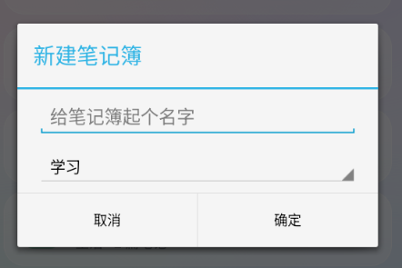
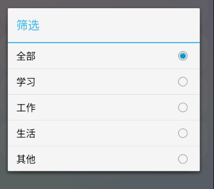
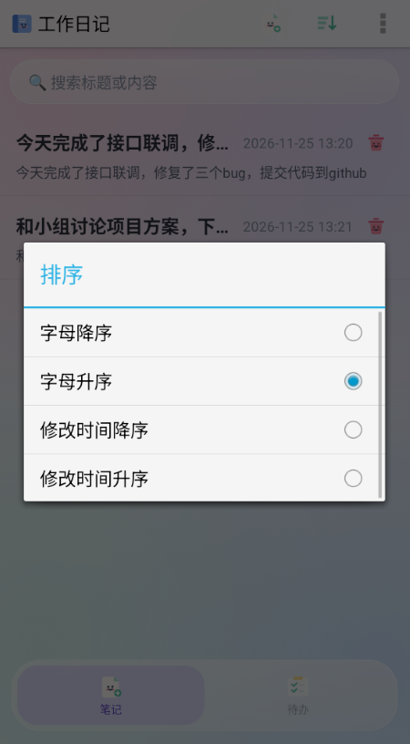
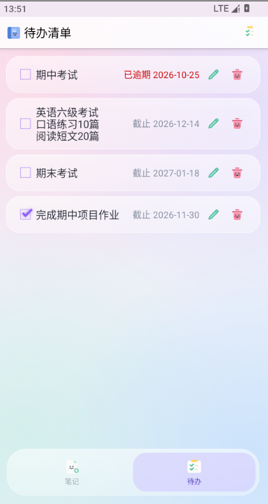
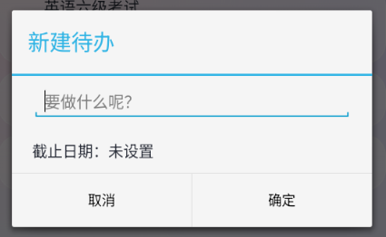
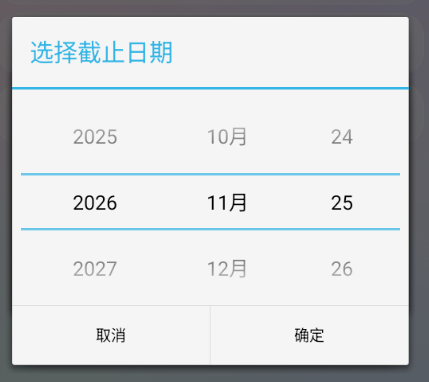
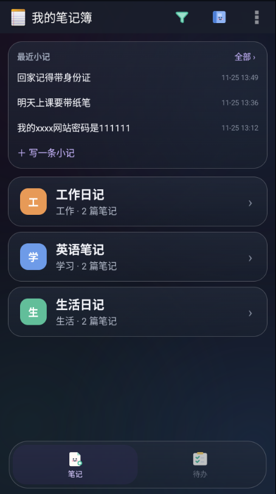

# 我的记事本（NotePad）

一款纯本地运行的 Android 记事应用，由 Google 经典的 NotePad 示例扩展而来。项目保留了 ContentProvider + SQLite 的教学骨架，并在此基础上完成了**笔记列表时间戳**与**笔记内容搜索**两项基础功能，同时实现了笔记本分类、未归类小记、笔记排序、独立待办清单（含截止日期）、可直接打勾的桌面小组件、夜间模式与手绘风毛玻璃界面等扩展功能。

应用不依赖任何第三方库，全部使用 Android 平台原生 API 实现；界面文案、弹窗与日期选择器均为中文。

---

## 目录

- [功能一览](#功能一览)
- [功能特性](#功能特性)
- [界面截图](#界面截图)
- [界面结构与交互流程](#界面结构与交互流程)
- [技术实现](#技术实现)
- [目录结构](#目录结构)
- [构建与运行](#构建与运行)
- [使用指南](#使用指南)
- [已知限制](#已知限制)

---

## 功能一览

| 类别 | 功能 | 实现说明 |
| --- | --- | --- |
| **基础功能** | 笔记列表显示时间戳 | 每条笔记右侧显示 `yyyy-MM-dd HH:mm` 格式的修改时间；首页「最近小记」显示 `MM-dd HH:mm` |
| **基础功能** | 笔记内容搜索 | 顶部搜索框实时过滤，按标题或正文关键字匹配，支持在单个笔记本与「全部小记」中使用 |
| **扩展功能** | 笔记本与分类 | 卡片式笔记本列表，支持学习/工作/生活/其他四类、按类别筛选、新建/重命名/删除 |
| **扩展功能** | 未归类小记 | 无需先建笔记本即可记小记；首页「最近小记」与「全部小记」只展示未归类笔记 |
| **扩展功能** | 笔记排序 | 字母降序、字母升序、修改时间降序、修改时间升序，选择结果会被记忆 |
| **扩展功能** | 待办清单 | 独立待办页，支持新增、编辑、勾选、删除、截止日期设置与按截止日期排序 |
| **扩展功能** | 桌面小组件 | 桌面展示未完成待办，可直接点击打勾完成，并同步完成统计 |
| **扩展功能** | 界面与主题 | 渐变毛玻璃风格、手绘风图标、日间/夜间一键切换并持久化 |
| **扩展功能** | 全中文界面 | 应用固定简体中文，日期选择器采用自绘中文滚轮，不依赖系统语言 |

---

## 功能特性

### 基础功能

#### 1. 笔记列表显示时间戳

- 每条笔记以扁平的纯文字行展示，行内包含标题、正文摘要和修改时间
- 时间戳格式为 `yyyy-MM-dd HH:mm`，随新建、编辑自动更新
- 首页「最近小记」区块同样显示 `MM-dd HH:mm` 格式的时间
- 笔记没有标题时，列表自动用正文开头（最多 20 字）代替标题，避免出现空白行

#### 2. 笔记内容搜索

- 笔记列表顶部提供搜索框，输入时实时过滤，无需点击搜索按钮
- 同时匹配**标题**与**正文**中的关键字
- 搜索结果仍保持当前选择的排序方式
- 在笔记本内搜索只作用于该笔记本；从「全部 ›」进入时只搜索未归类小记

### 扩展功能

#### 1. 笔记本与分类

- 应用启动后进入「我的笔记簿」页面，以卡片形式展示全部笔记本，卡片左侧是类别色徽标、右侧是进入箭头
- 每个笔记本属于一个类别：**学习 / 工作 / 生活 / 其他**
- 支持新建笔记本（填写名称并选择类别）、重命名、删除；重命名与删除通过**长按**笔记本卡片触发
- 删除笔记本会级联删除其中的全部笔记
- 顶部栏提供**分类筛选**按钮，可按类别只看某一类笔记本；筛选后标题下方显示「筛选：学习」等副标题，选择「全部」恢复完整列表

#### 2. 未归类小记

- 首页顶部提供「最近小记」区块，只展示最近修改的 3 条未归类小记，点击即可继续编辑
- **写笔记不强制先建笔记本**：点击「＋ 写一条小记」直接进入编辑器，保存后成为未归类笔记
- 点击「全部 ›」进入「全部小记」列表，只列出未归类的小记，不混入任何笔记本内的笔记

#### 3. 笔记管理

- 在笔记本内新建、编辑、删除笔记；编辑器顶部提供标题输入框，正文在下方
- 标题留空时自动取正文开头作为标题；标题与正文均可在编辑器中修改
- 支持四种排序方式，选择结果会被记忆，下次进入仍然生效：
  - 字母降序
  - 字母升序
  - 修改时间降序（默认）
  - 修改时间升序
- 笔记列表使用扁平的纯文字行，与笔记本卡片在视觉上明显区分；行内提供删除按钮，无需进入笔记即可删除
- 长按笔记弹出上下文菜单，可「打开」或「删除」

#### 4. 待办清单

- 独立的「待办」页面，与笔记解耦，通过底部导航栏切换
- 支持新增待办、勾选完成、取消完成、删除
- 点击待办行或铅笔图标可进入编辑，修改待办内容
- 支持为待办设置截止日期（可随时修改或清除），未设置时显示创建时间；日期通过自绘的年/月/日中文滚轮选择，不受系统语言影响
- 列表按「未完成优先 → 截止日期升序 → 创建时间」排序，已逾期的截止日期以红色显示

#### 5. 桌面便签小组件

- 4×3 桌面小组件，展示**未完成的待办**（最多 5 条）
- 每行待办前带手绘风小方框，**点击整行即可在桌面直接打勾完成**，该行随即消失
- 底部显示「共 X 项 · 已完成 Y 项」统计
- 点击组件空白区域打开应用内的待办清单页面
- 空状态提示：没有待办时引导去添加，全部完成时显示鼓励文案
- 笔记或待办数据变更后，ContentProvider 发送广播，组件即时刷新；另有 30 分钟定时刷新兜底

#### 6. 界面与主题

- 毛玻璃视觉风格：渐变背景 + 半透明圆角卡片 + 1dp 高光描边
- 日间 / 夜间模式一键切换，选择持久化保存，重启后保持
- 全套手绘风可爱矢量图标（新建、删除、保存、排序、筛选、待办等）
- 底部导航栏在「笔记」与「待办」之间切换，当前项高亮
- 应用固定使用简体中文，弹窗与选择器均为中文

---

## 界面截图

> 截图均保存在项目根目录的 `screenshots/` 文件夹中，与下文引用的文件名一一对应。

### 1. 笔记簿列表




展示全部笔记本。每张卡片左侧为类别色徽标（学习/工作/生活/其他），右侧为进入箭头，中间是名称与笔记数量；长按卡片可重命名或删除。页面顶部是「最近小记」区块，只列出最近 3 条未归类小记并提供「＋ 写一条小记」与「全部 ›」入口；顶部栏从左到右依次为分类筛选、新建笔记本与更多菜单。

### 2. 分类筛选



点击顶部漏斗按钮弹出单选列表，包含「全部」与四个类别，当前选项带勾选标记；选择后列表立即过滤，并在标题下方显示当前筛选状态。

### 3. 笔记列表、搜索与排序


某个笔记本下的全部笔记，顶部为搜索框，列表项采用扁平的纯文字样式，显示标题、摘要与修改时间，行尾提供删除按钮；从「全部 ›」进入时标题为「全部小记」，只显示未归类的笔记。



点击排序按钮后可在「字母降序 / 字母升序 / 修改时间降序 / 修改时间升序」中单选，选中结果写入偏好设置并在下次进入时恢复。


直接在搜索框输入文字，将自动显示标题或正文匹配的笔记条目。

### 4. 笔记编辑


编辑器上方为标题输入框、下方为正文输入区；内容在退出时自动保存，标题留空时自动取正文开头。顶部提供保存与删除按钮。

### 5. 待办清单





独立待办页面，支持新增、编辑、勾选、删除；可设置截止日期并按截止日期排序，逾期项以红色提示，行尾提供编辑与删除图标。

### 6. 夜间模式




切换夜间模式后的同款毛玻璃界面，配色由 `values-night` 资源自动接管，无需重启应用。

### 7. 桌面便签小组件


桌面小组件列出未完成待办，每行带手绘勾选框；底部显示完成统计。在桌面直接点击某行即可标记完成，该行立即从组件中移除，统计同步更新。

---

## 界面结构与交互流程

```
NotebookList（启动页：我的笔记簿）
    ├── 最近小记区块：只显示未归类小记 / 点击直接编辑 / 「＋ 写一条小记」新建 / 「全部 ›」进入全部小记
    ├── 顶部：筛选 / 新建笔记本 / 更多（日夜模式切换）
    ├── 点击笔记本 ──> NotesList（该笔记本下的笔记）
    │        ├── 搜索框、排序按钮、行内删除
    │        └── 点击笔记 ──> NoteEditor（编辑标题与正文）
    └── 底部导航 ──> TodoList（待办清单，与笔记并列）

系统桌面 ── 桌面便签小组件 ──> 点击行直接打勾 / 点击空白处打开 TodoList
```

主要交互路径：

1. **快速记录**：启动 → 首页「最近小记」→「＋ 写一条小记」→ 直接编辑保存，无需先建笔记本
2. **浏览与筛选**：启动 → 笔记簿列表 → 顶部筛选按钮选择类别 → 列表即时过滤
3. **写作**：进入笔记本 → 新建/打开笔记 → 编辑标题与正文 → 自动保存
4. **查找**：笔记列表输入关键字，实时显示匹配结果
5. **整理**：切换排序方式改变展示顺序，行内删除或长按菜单删除笔记
6. **待办**：底部导航进入待办页新增与勾选；在桌面组件上也能完成勾选
7. **主题**：更多菜单切换夜间/日间模式，界面重建并保留当前页面

---

## 技术实现

### 技术栈

| 项目 | 说明 |
| --- | --- |
| 开发语言 | Java（不含 Kotlin） |
| 最低版本 | minSdk 11（Android 3.0） |
| 编译 / 目标版本 | compileSdk 23、targetSdk 23 |
| 构建工具 | Android Gradle Plugin 8.12.2、Gradle 8.13 |
| 数据存储 | ContentProvider + SQLite（数据库版本 6） |
| 界面组件 | Activity、SimpleCursorAdapter、AlertDialog、ActionBar 菜单 |
| 桌面组件 | AppWidgetProvider + RemoteViews |
| 第三方依赖 | 无 |

### 整体架构

项目采用经典的三层结构：

1. **界面层**：`NotebookList`、`NotesList`、`NoteEditor`、`TodoList` 等 Activity，通过 `ContentResolver` 访问数据，不直接操作数据库
2. **数据访问层**：`NotePadProvider` 继承 `ContentProvider`，统一处理三张表的增删改查、级联删除与数据库升级；`NotePad` 契约类集中定义表名、列名、URI 与 MIME 类型
3. **存储层**：SQLite 数据库保存结构化数据

跨层联动：所有写操作在 `notifyChange` 之后额外发送 `ACTION_NOTES_CHANGED` 广播，桌面小组件接收后重新查询并刷新界面，实现「应用内改动，桌面即时可见」。

### 数据模型

| 表名 | 字段 | 说明 |
| --- | --- | --- |
| `notebooks` | `_id`、`name`、`category`、`created`、`modified` | 笔记本，类别取值为学习/工作/生活/其他 |
| `notes` | `_id`、`title`、`note`、`notebook_id`、`created`、`modified` | 笔记，`notebook_id` 指向所属笔记本；为 `NULL` 时表示未归类小记 |
| `todos` | `_id`、`note_id`、`content`、`done`、`created`、`deadline` | 待办，`done` 为 0/1；`deadline` 为截止日期时间戳，可为空；`note_id` 可为空，当前待办独立于笔记 |

关系说明：

- 一个笔记本包含多条笔记（一对多）
- 删除笔记本时级联删除其中的笔记

### 关键类职责

| 类 | 职责 |
| --- | --- |
| `NotePad` | 数据契约：三张表的表名、列名、Content URI、MIME 类型与默认排序 |
| `NotePadProvider` | ContentProvider 实现：多表 CRUD、级联删除、数据库升级、数据变更广播 |
| `NotebookList` | 启动页：笔记本卡片列表、最近小记、分类筛选、新建/重命名/删除、日夜模式切换 |
| `NotesList` | 笔记列表：按笔记本或未归类查询、搜索、排序、行内删除 |
| `NoteEditor` | 笔记编辑：标题与正文编辑、自动保存、空笔记清理 |
| `TodoList` | 待办清单页面：新增、编辑、勾选、删除、截止日期设置与排序 |
| `NoteWidgetProvider` | 桌面小组件：展示未完成待办、处理桌面打勾、点击跳转 |
| `ThemeUtils` | 日夜模式读取与主题包装 |
| `BottomNav` | 底部导航栏绑定与高亮切换 |

### 关键实现细节

**时间戳显示**：`NotesList` 使用 `SimpleCursorAdapter` 绑定 `modified` 列，并在 `ViewBinder` 中通过 `SimpleDateFormat("yyyy-MM-dd HH:mm")` 格式化；`NotebookList` 的「最近小记」使用 `MM-dd HH:mm` 格式。

**搜索**：`NotesList#queryNotes()` 将关键字包装为 `LIKE ?` 条件，同时对标题与正文匹配；输入框的 `TextWatcher` 在内容变化时触发重新查询，配合 `ContentObserver` 保证数据变化后列表自动刷新。

**分类筛选**：`NotebookList` 持有 `mCategoryFilter` 字段，查询时拼接 `category = ?` 条件；`null` 表示全部。筛选弹窗使用 `AlertDialog#setSingleChoiceItems`，选择后立即重新查询，并通过 `ActionBar#setSubtitle` 显示当前筛选状态。筛选值通过 `onSaveInstanceState` 在屏幕旋转时保留。

**未归类小记**：`notes.notebook_id` 允许为 `NULL`。新建小记时不写入该列；首页「最近小记」与「全部小记」查询均附加 `notebook_id IS NULL` 条件。

**笔记排序**：`NotesList` 将四种排序表达式定义为常量数组，查询时作为 `sortOrder` 传给 `ContentResolver#query`；选择结果写入 `SharedPreferences`（`notepad_prefs` / `note_sort_order`），启动时读取恢复。

**笔记标题**：编辑器顶部为单独的标题输入框，退出时与正文一起写入；标题为空时用正文前 30 字生成，列表在标题为空时再回退显示正文前 20 字。

**待办截止日期**：`todos` 表保存可空的 `deadline` 时间戳，编辑对话框通过自绘的年/月/日中文滚轮选择日期（当天 23:59 为截止时刻），查询时按「未完成 → 截止日期升序（未设置排最后）→ 创建时间」排序；未设置截止日期的行回退显示创建时间，逾期未完成的截止日期以红色高亮。

**毛玻璃风格**：通过渐变背景图、半透明白色圆角卡片与 1dp 描边叠加模拟玻璃质感，未使用真实模糊，兼容低版本系统。

**日夜模式**：`ThemeUtils` 读取 `notepad_prefs` 中的 `night_mode` 偏好，在 Activity 创建前包装主题；夜间配色由 `values-night/colors.xml` 提供，切换后调用 `recreate()`。

**桌面小组件**：`NoteWidgetProvider` 在 `onUpdate` 中查询未完成待办，拼接文本后写入 `RemoteViews` 的固定 5 行布局；每行绑定独立的 `PendingIntent`，携带待办 id 的广播由 Provider 自身接收并将 `done` 置 1，随后刷新全部组件实例。点击组件空白区域则跳转 `TodoList`。

---

## 目录结构

```
NotePad/
├── app/
│   ├── build.gradle
│   └── src/
│       └── main/
│           ├── AndroidManifest.xml
│           ├── java/com/example/android/notepad/ # 全部业务代码
│           └── res/
│               ├── drawable/                     # 毛玻璃背景、手绘图标、组件背景
│               ├── layout/                       # 页面、列表项、底部导航、组件布局
│               ├── menu/                         # 各页面顶部菜单
│               ├── values/                       # 字符串、颜色、样式、类别数组
│               ├── values-night/                 # 夜间模式配色
│               └── xml/note_widget_info.xml      # 桌面小组件配置
├── screenshots/                                  # README 界面截图
├── build.gradle
├── gradle/wrapper/
├── settings.gradle
└── README.md
```

---

## 构建与运行

1. 使用 Android Studio 打开工程，等待 Gradle 同步完成
2. 编译 Debug 包：

   ```bash
   # Windows
   gradlew.bat :app:assembleDebug

   # macOS / Linux
   ./gradlew :app:assembleDebug
   ```

3. 安装到设备或模拟器：

   ```bash
   adb install -r --bypass-low-target-sdk-block app/build/outputs/apk/debug/app-debug.apk
   ```

   > `targetSdkVersion` 为 23，Android 14 及以上系统安装时需要 `--bypass-low-target-sdk-block` 参数；也可以直接在 Android Studio 中点击运行。

4. 安装完成后即可直接启动应用。

---

## 使用指南

### 笔记

1. 启动应用进入「我的笔记簿」
2. 点击顶部漏斗图标筛选类别，或点击新建图标创建笔记本
3. 点击笔记本进入笔记列表，使用顶部搜索框查找、排序按钮调整顺序
4. 点击笔记进入编辑页，修改标题与正文后自动保存
5. 行尾删除按钮可直接删除笔记，操作前会弹出确认框

### 待办

1. 底部导航切换到「待办」
2. 输入内容后点击确定即可添加；新建时可一并选择截止日期
3. 勾选即可标记完成；点击待办行或铅笔图标可编辑内容与截止日期
4. 点击行尾删除图标可删除待办

### 桌面便签

1. 长按桌面空白处 → 小部件 → 我的记事本 → 长按「桌面便签」拖到桌面
2. 组件会列出最多 5 条未完成待办
3. 直接点击某行即在桌面完成该待办；点击空白区域打开应用内待办页

### 主题

- 在笔记簿页面的更多菜单中选择「夜间模式 / 日间模式」进行切换

---

## 已知限制

- 项目沿用较旧的 `targetSdkVersion 23`，在较新 Android 系统上以兼容模式运行
- 毛玻璃效果为渐变与半透明图层模拟，并非真实的背景模糊
- 分类筛选只在当前页面生命周期内保留，应用重启后恢复为「全部」
- 桌面小组件最多显示 5 条未完成待办，超出部分需进入应用查看

---

